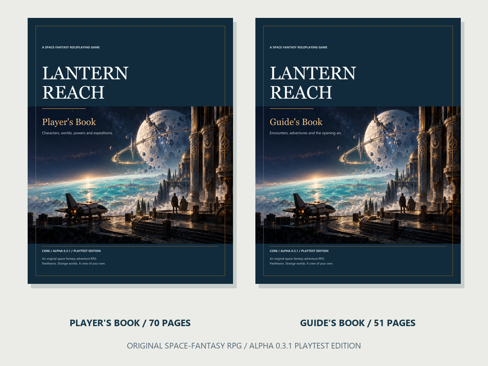

# Lantern Reach

**A free space-fantasy tabletop RPG playtest.** A ship, a conviction, and somewhere new to go.

**Start here: [download the full alpha](https://github.com/brendenberg/lantern-reach-playtest/releases/download/v0.1.0/Lantern-Reach-Public-Playtest.zip).** Four PDF books, six maps, no purchase or account needed to download. This is a tabletop game, not a video game.

**Unfinished alpha · seeking human table feedback.** Automated checks do not establish balance or player enjoyment.

Build an explorer, gather a crew, and choose your next voyage. Investigate silent stations, negotiate with rival interests, discover strange worlds, and decide what your convictions mean when the frontier puts them under pressure.

Pantheons stand alongside your Vocation and embodied form as a major character choice. Humanity includes biological, engineered, mechanical, psionic, religious, and secular ways of living. Faith matters without requiring every adventure to be a religious conflict.

## Download and play

**[Download the complete public playtest kit](https://github.com/brendenberg/lantern-reach-playtest/releases/download/v0.1.0/Lantern-Reach-Public-Playtest.zip)** — four PDF books, six printable SVG maps, and these instructions. No purchase or account required to download.

| Book | What you get |
| --- | --- |
| [Player’s Book](books/Lantern-Reach-Players-Book.pdf) · 70 pages | Character creation, core rules, abilities, gear, and crew play |
| [Guide’s Book](books/Lantern-Reach-Guides-Book.pdf) · 51 pages | Running the game, opposition, adventures, and table guidance |
| [Explorer’s Expansion](books/Lantern-Reach-Explorers-Expansion.pdf) · 38 pages | More character options and expedition material |
| [Frontier Guide](books/Lantern-Reach-Frontier-Guide.pdf) · 40 pages | More places, people, and situations to explore |

Start with the Player’s Book and Guide’s Book. The expansions are optional. One person acts as the Guide; the others each play an explorer. Gather ordinary six-sided dice, character notes, and a way to track resources. Choose ready characters for your first session, name your shared ship, and begin with **The Silent Berth** in the Guide’s Book. Use [its station map](maps/silent-berth.svg). The books contain the rules and adventure material; no other game’s rulebook is required.

The core resolution uses **2d6**, clear stakes, and consequences. Combat sits alongside exploration, rescue, negotiation, and crew life. This is an original system; it is not a compatible supplement for Dungeons & Dragons or Warhammer.

## Your first session

You do not need to read all 199 pages before trying the game.

1. Gather **two ordinary six-sided dice**, paper, and a way to track resources. The core game supports **two to four players and one Guide**, with a duet option for one player and one Guide.
2. Players: open the **Player’s Book, page 4**, for the first-voyage setup. Choose ready characters and name your shared ship.
3. Guide: begin with **Guide’s Book, page 4**, for preparation and pacing, then read **The Silent Berth, starting on page 13**. Keep the [station map](maps/silent-berth.svg) and **Player’s Book, page 70**, ship reference available.
4. Agree on the tone, excluded subjects, and how anyone can pause a scene. Try the opening adventure; the expansion books are optional.
5. Report one specific moment that worked or caused trouble. Include the book/page and what the group tried. You do not need to finish a session for your feedback to be useful.

Page numbers refer to the released Alpha 0.3.1 books inside Public Alpha 0.1.0.

## Before you download

- **Is it free?** Yes. The full public kit is free; there is no paid-only content in this release.
- **Is it finished?** No. It is an alpha seeking human playtests. No balance, enjoyment, or release-date guarantee is made.
- **What do I get?** Four PDF books totaling 199 pages and six printable SVG maps, plus instructions and the playtest permission.
- **Do I need another game?** No. These books contain an original rules system.
- **Is software included?** No. The optional software companion mentioned in the books is not included in this public kit.
- **Can I reuse it commercially?** No commercial-use or adaptation license is granted by the free download. See the included permission.

## Help shape the game

**[Send session feedback](https://github.com/brendenberg/lantern-reach-playtest/issues/new?template=session-feedback.yml)** or **[report a rules problem](https://github.com/brendenberg/lantern-reach-playtest/issues/new?template=rules-problem.yml)**. A free GitHub account is needed to submit an issue. Feedback is public: omit player names and personal information.

The most useful reports tell us: which book and page; what your group tried; what happened; what felt exciting, slow, unclear, or unfair; and what you would change. Reports of a session ending early are useful too.

## Playtest status and credits

**Public alpha 0.1.0 · October 25, 2026.** Rules and presentation will change. This edition has undergone automated rules checks and scripted scenario simulations. Those are not human playtests, and the game is not claimed to be balanced or complete. We are now seeking real table feedback.

Published by the repository owner. No affiliation with Dungeons & Dragons, Wizards of the Coast, Warhammer, or Games Workshop is implied.

Free playtest access does not grant an open-source or commercial-use license. See [PLAYTEST-PERMISSION.txt](PLAYTEST-PERMISSION.txt).
