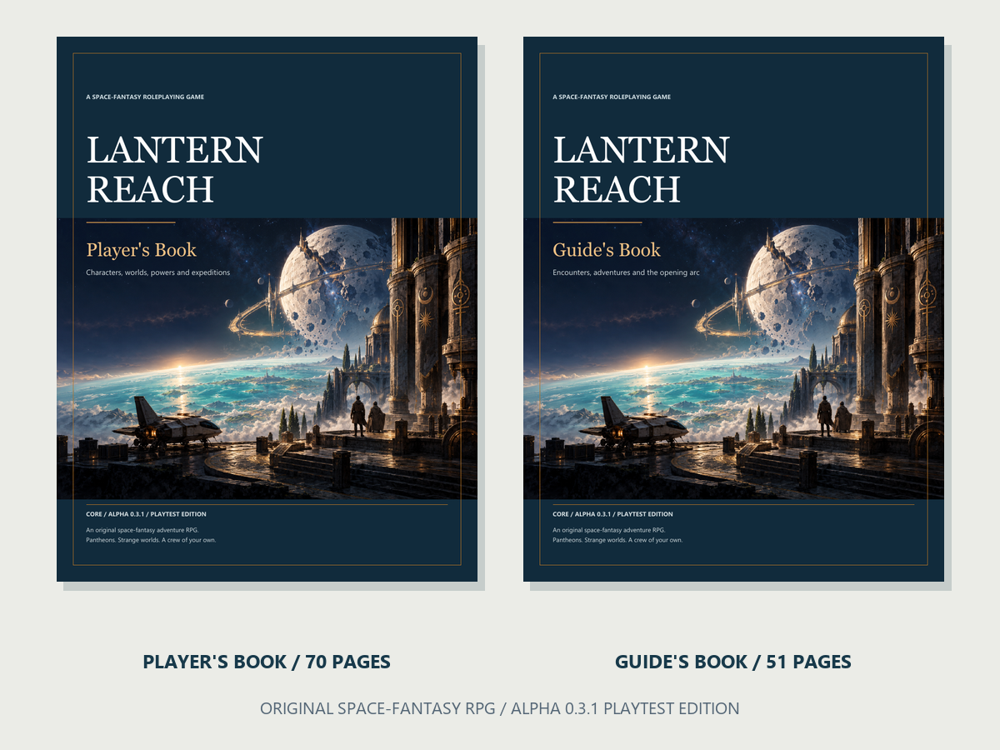

# Lantern Reach

**A free space-fantasy tabletop RPG playtest.** A ship, a conviction, and somewhere new to go.

Build an explorer, gather a crew, and choose your next voyage. Investigate silent stations, negotiate with rival interests, discover strange worlds, and decide what your convictions mean when the frontier puts them under pressure.

Pantheons stand alongside your Vocation and embodied form as a major character choice. Humanity includes biological, engineered, mechanical, psionic, religious, and secular ways of living. Faith matters without requiring every adventure to be a religious conflict.

## Download and play

**[Download the complete public playtest kit](https://github.com/brendenberg/lantern-reach-playtest/releases/latest/download/Lantern-Reach-Public-Playtest.zip)** — four PDF books, six printable SVG maps, and these instructions. No purchase or account required to download.

| Book | What you get |
| --- | --- |
| [Player’s Book](books/Lantern-Reach-Players-Book.pdf) · 70 pages | Character creation, core rules, abilities, gear, and crew play |
| [Guide’s Book](books/Lantern-Reach-Guides-Book.pdf) · 51 pages | Running the game, opposition, adventures, and table guidance |
| [Explorer’s Expansion](books/Lantern-Reach-Explorers-Expansion.pdf) · 38 pages | More character options and expedition material |
| [Frontier Guide](books/Lantern-Reach-Frontier-Guide.pdf) · 40 pages | More places, people, and situations to explore |

Start with the Player’s Book and Guide’s Book. The expansions are optional. One person acts as the Guide; the others each play an explorer. Gather ordinary six-sided dice, character notes, and a way to track resources. Choose ready characters for your first session, name your shared ship, and begin with **The Silent Berth** in the Guide’s Book. Use [its station map](maps/silent-berth.svg). The books contain the rules and adventure material; no other game’s rulebook is required.

The core resolution uses **2d6**, clear stakes, and consequences. Combat sits alongside exploration, rescue, negotiation, and crew life. This is an original system; it is not a compatible supplement for Dungeons & Dragons or Warhammer.

## Help shape the game

**[Send session feedback](https://github.com/brendenberg/lantern-reach-playtest/issues/new?template=session-feedback.yml)** or **[report a rules problem](https://github.com/brendenberg/lantern-reach-playtest/issues/new?template=rules-problem.yml)**. A free GitHub account is needed to submit an issue. Feedback is public: omit player names and personal information.

The most useful reports tell us: which book and page; what your group tried; what happened; what felt exciting, slow, unclear, or unfair; and what you would change. Reports of a session ending early are useful too.

## Playtest status and credits

**Public alpha 0.1.0 · October 25, 2026.** Rules and presentation will change. This edition has undergone automated rules checks and scripted scenario simulations. Those are not human playtests, and the game is not claimed to be balanced or complete. We are now seeking real table feedback.

Created with substantial AI assistance, including writing, rules development, software-assisted checks, layout, and generated artwork. Published by the repository owner. No affiliation with Dungeons & Dragons, Wizards of the Coast, Warhammer, or Games Workshop is implied.

Free playtest access does not grant an open-source or commercial-use license. See [PLAYTEST-PERMISSION.txt](PLAYTEST-PERMISSION.txt).
